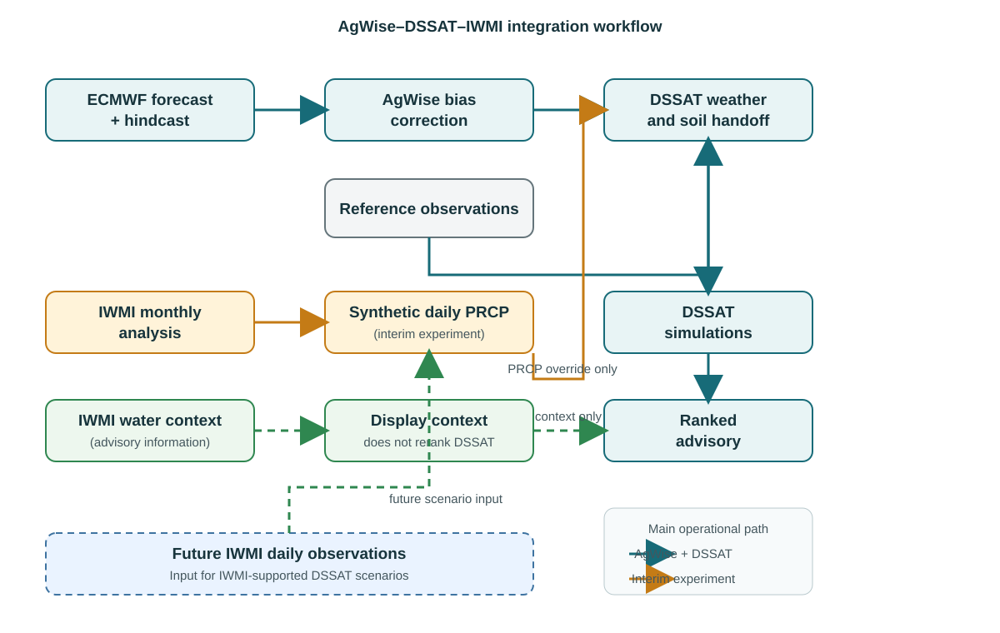

# End-of-Internship Report — Detailed Integration Methods
## AgWise–DSSAT–IWMI integration for maize advisory development in Chókwè, Mozambique

**Project period:** 2026  
**Case study:** Chókwè, Mozambique | Maize | 2025/26 season

## 1. Introduction

This report expands the original end-of-internship report by documenting the
methodology and evidence for the three IWMI integration approaches developed
during the internship:

1. IWMI water-context integration in the advisory layer.
2. An interim synthetic rainfall experiment using IWMI monthly analysis totals.
3. The preferred operational approach: an IWMI-supported, scenario-based DSSAT
   workflow that will use validated IWMI daily observations when available.

The normal AgWise–DSSAT workflow remains the foundation. AgWise provides the
seasonal forecast, bias correction, and DSSAT weather preparation; DSSAT
simulates planting-date and cultivar treatments; the advisory layer ranks and
explains the results. IWMI information is added through explicitly labelled
interfaces so contextual products are not mistaken for target-season weather
inputs.

## 2. Shared workflow and study design

The Chókwè use case covers `2025-11-01` to `2026-02-28`, uses a one-month
forecast lead, maize cultivar ID `900111`, and the manual extent
`-23.5, 32.5, -25.5, 33.5` in `[N,W,S,E]` order. The shared DSSAT variables
are daily `PRCP`, `TMAX`, `TMIN`, and `SRAD`.

AgWise bias correction uses historical reference observations and model
hindcasts to learn systematic forecast errors, then applies the correction to
the new forecast. Corrected AgWise temperature and solar-radiation fields
remain in the DSSAT handoff for the interim rainfall experiment. When enabled,
the rainfall override changes only `PRCP`/DSSAT `RAIN` on overlapping dates.

To keep results interpretable, comparisons must hold the following constant:
forecast period, DSSAT executable, soil inputs, cultivar options, grid-cell
set, forecast files, and model settings. The original broad run used 62 cells;
the controlled current comparison used the same localized 13-cell set for both
rainfall scenarios.

## 3. Methodology

### 3.1 Approach 1 — IWMI water context in the advisory layer

**Purpose.** Add water-related information without changing the DSSAT
simulation or silently altering the recommendation.

**Inputs and processing.** The IWMI adapter discovers STAC items, records the
collection and asset provenance, samples the nearest raster cell when
requested, applies scale and offset metadata, and preserves both decoded and
raw values. The advisory separates temporal roles:

- Historical rainfall anomaly: contextual reference, not a current-season
  observation or forecast.
- ET fraction: displayed with the product-definition warning because linked
  metadata conflict for that collection.
- Irrigation probability: reported as a probability, not a binary irrigated
  classification.
- Evaporative stress: reported as a unitless index with provisional project
  bands; these are not an IWMI product legend.

The normalized payload records source URLs, period, temporal role, coordinates,
unit, scale, offset, and sampling method. Context values are displayed beside
the DSSAT result and do not enter the treatment-ranking function.

### 3.2 Approach 2 — Synthetic daily rainfall from monthly IWMI analysis

**Purpose.** Test the response of DSSAT to IWMI monthly rainfall totals while
daily IWMI observations are unavailable.

The Digital Twins `/chatbot/rainfall_analyses` export supplied 309 monthly
values from 2001-01 through 2026-09. It is not a daily observational dataset:
the metadata records `daily_observations: false`. The existing 2001–2016
values match all 192 overlapping months in the new export.

For each month with target total \(M\) and \(D\) days:

1. Select the exact target-year `YYYY-MM` total when available.
2. Set the number of wet days to \(K=\max(1,\mathrm{round}(Df))\), with
   \(f=0.25\) by default.
3. Select \(K\) days reproducibly without replacement.
4. Draw event weights \(w_i\sim\mathrm{Gamma}(1.5,1.0)\).
5. Allocate rainfall using
   \[
   R_i=M\frac{w_i}{\sum_j w_j}.
   \]

Dry days receive zero; the wet-day values sum to the monthly target, subject
to output rounding. For 2025/26 the selected totals were 139.50, 140.35,
209.99, and 16.47 mm for November through February, with no climatology
fallback. The resulting daily sequence is synthetic and is replicated across
DSSAT forecast points. It does not reconstruct observed storm timing,
persistence, extremes, spatial variation, or rainfall–temperature dependence.

The synthetic file is passed as `IWMI_PRCP_CSV`. At the DSSAT handoff,
synthetic rainfall replaces AgWise PRCP only on covered dates; AgWise
`TMAX`, `TMIN`, and `SRAD` remain in use. The synthetic series is not sent
through AgWise bias correction because exact IWMI monthly totals are the
experimental target.

### 3.3 Approach 3 — IWMI-supported DSSAT scenarios

**Purpose.** Establish the preferred operational integration by using IWMI
rainfall to support scenario-based DSSAT simulations alongside the AgWise
baseline.

Approach 2 and Approach 3 use the same DSSAT scenario interface. The
difference is the rainfall input: Approach 2 uses temporary synthetic daily
rainfall because observations are unavailable, while Approach 3 replaces that
temporary input with provider-confirmed IWMI daily observations.

The daily IWMI series must include date/time
convention, units, coordinates or grid definition, quality flags,
missing-value rules, station/channel identity, and a documented historical
overlap. The recommended sequence is:

1. Obtain daily observations for Chókwè and the longest common period,
   ideally 1994–2016.
2. Validate units, timestamps, completeness, duplicates, missing values, and
   station location.
3. Compare IWMI with the existing AgWise reference using monthly totals,
   wet-day frequency, dry-spell length, extremes, seasonal totals, bias, and
   correlation.
4. Generate an IWMI-supported DSSAT scenario while retaining the AgWise run as
   the baseline.
5. Compare rainfall totals, yields, rankings, and spatial results using
   matched cells and identical DSSAT settings.
6. Repeat across seasons before considering operational advisory use.

This approach is not yet runnable as an operational result because IWMI daily
observations and complete metadata are still pending. The monthly analysis
export is only a temporary input and cannot substitute for daily observations.

## 4. Results by integration approach

| Approach | What was measured | Result | Readiness |
|---|---|---|---|
| 1. Advisory context | Availability, provenance, units, periods, and display of four IWMI layers | Rainfall anomaly -12.91%; ET fraction 0.60%; irrigation probability 0.036; stress index 0.50; no DSSAT reranking | Implemented as qualified context |
| 2. Temporary synthetic PRCP | Matched DSSAT treatment summary using 13 cells | Recommendation remained 30 Nov 2025, Short; median yield changed 2,996 → 2,973 kg/ha (-23 kg/ha; -0.77%) | Temporary bridge |
| 3. IWMI-supported scenarios | Scenario comparison using provider-confirmed daily observations | Pending IWMI daily data; same DSSAT scenario interface will be reused | Main target |

### 4.1 Approach 1 result

The advisory successfully carried contextual IWMI values with source,
sampling, temporal-role, and limitation metadata. The historical rainfall
anomaly was not interpreted as a 2025/26 forecast. The context was therefore
useful for interpretation, but it did not alter the DSSAT ranking.

### 4.2 Approach 2 result

The controlled 13-cell comparison produced:

| Metric | AgWise PRCP baseline | IWMI synthetic PRCP | Difference |
|---|---:|---:|---:|
| Recommended date | 30 Nov 2025 | 30 Nov 2025 | Unchanged |
| Cultivar | Short | Short | Unchanged |
| Median HWAH | 2,996 kg/ha | 2,973 kg/ha | -23 (-0.77%) |
| Number of simulations | 13 | 13 | Matched |

The original broad 62-cell run reported 2,976 kg/ha and a 2,025–3,132 kg/ha
spatial P10–P90 range. The current 13-cell run reported 2,973 kg/ha and a
2,895–3,065 kg/ha range. These broad and localized results are not a
rainfall-only comparison because their spatial populations differ.

### 4.3 Approach 3 result status

There is no daily-observation scenario result yet. The completed result is a
documented scenario design: once IWMI supplies a confirmed daily series, the
temporary synthetic file can be replaced without changing the DSSAT scenario
interface, advisory contract, or ranking logic.

## 5. Conclusions and handover

All three integration surfaces are now defined. Approach 1 demonstrates safe
contextual advisory enrichment. Approach 2 demonstrates the temporary
rainfall-scenario interface while daily data are unavailable. Approach 3 is
the main operational objective: use IWMI daily rainfall to support
scenario-based DSSAT comparison with the AgWise baseline.

The interim synthetic result is encouraging because the recommendation was
stable, but it is not evidence that synthetic rainfall is equivalent to daily
observations. The next milestone is to obtain and validate IWMI daily data,
resolve the returned station-identifier mismatch, replace the temporary
synthetic scenario input, and repeat the comparison over multiple seasons
using identical DSSAT cells and inputs.
